# Anatomize

**A 2D anatomical sandbox where the body actually reacts.**

切开一个人，你能看见血从压力最高的地方喷出来，看见伤口下游的组织一点点变白、变紫、坏死，看见他心跳加快、呼吸变浅，然后软下去。

> 状态：**能玩了** — 双击 `anatomize.exe`：主菜单 → 选世界 → 切人。
> 12 个工具：切、砸、拖、冻、删，加上焊接 / 钉住 / 绳 / 铰链 / 活塞 —— 能把零件拼成机器。
> 人偶生成之后就站着，不抖、不歪。可以放很多具——每一具都是自己的生理和组织场。

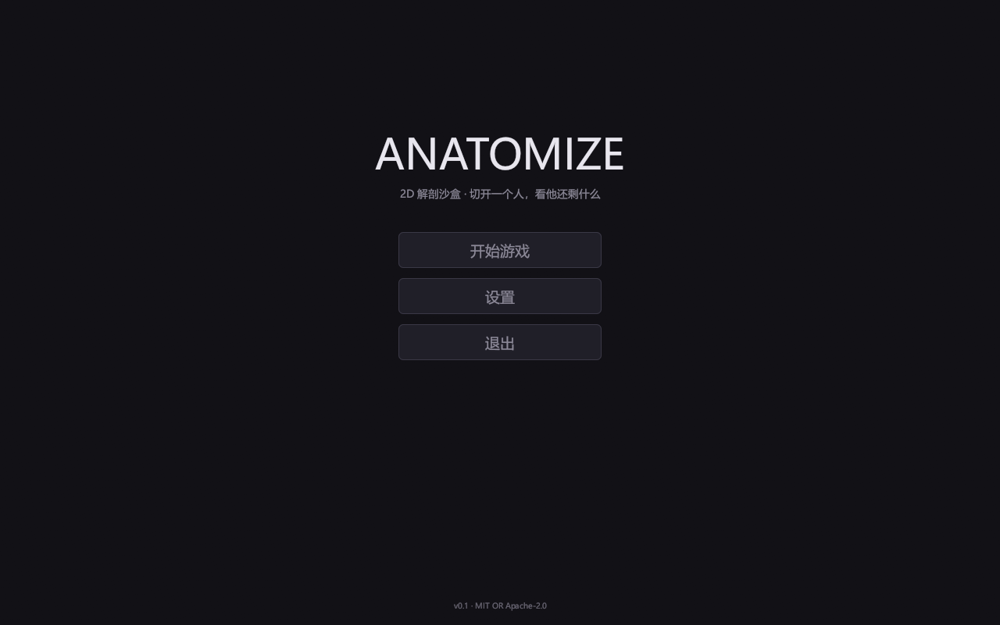

<sub>主菜单。开始游戏 → 选世界（新建或读档）→ 进游戏。ESC 随时回这里。</sub>

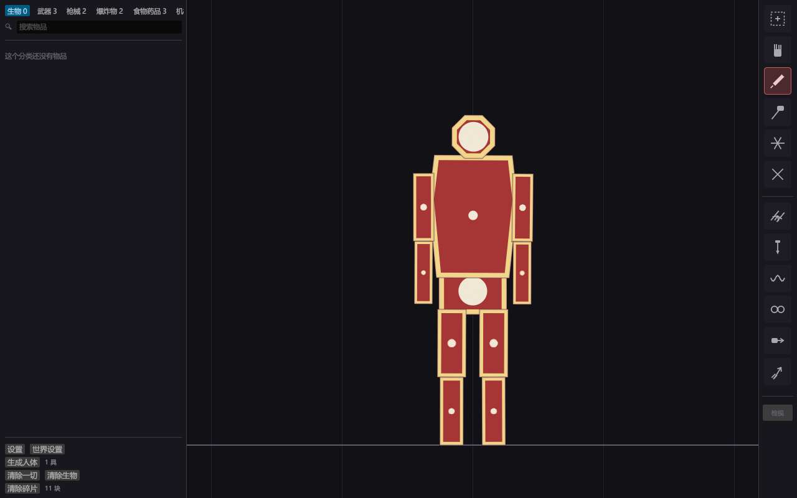

<sub>游戏内。**左栏**：分类 tab / 搜索 / 物品网格 / 底部（设置 · 世界设置 · 清除一切 · 清除生物 · 清除碎片）。**右栏**：工具（选择 / 手 / 刀 / 锤 / 使用 / 冻结 / 删除）+ 检视入口。中间是有边界的世界。断面按层厚逐层内缩：皮肤、脂肪、肌肉、骨。</sub>

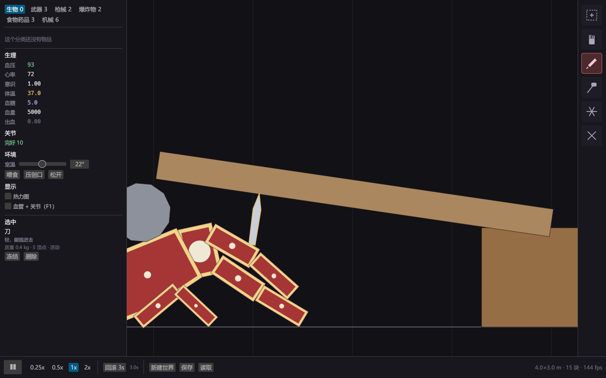

<sub>生成物品之后。木箱、铁球、长板、刀——它们和身体走同一条物理路径：能被切、被冻、被拖、被存进存档。</sub>

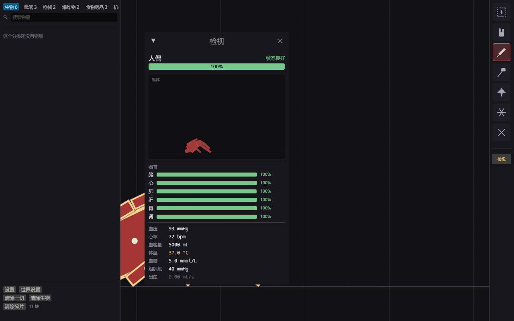

<sub>检视（右栏「检视」或 Tab）。**总生命值取最差的那个环节**——血压、组织氧、血容量、体温、血糖、意识，任一断掉人就倒了。中间是躯体图：每块按组织场的平均损伤着色。下面是六个器官，从生理指标反推（脑看意识和组织氧、心看 MAP 和心输出量、肺看 SaO2……）。</sub>

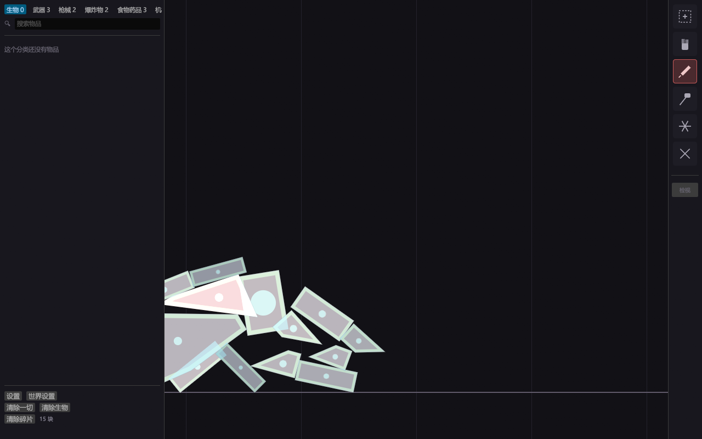

<sub>热力图（F2）。**每块一层色，色跟着肉走**——不是"整个 ragdoll 背后贴一张图"。主块每帧从组织场现算平均值（看得到出血、缺氧、降温的变化），切下来的碎片带着切开那一刻的快照飞走。</sub>

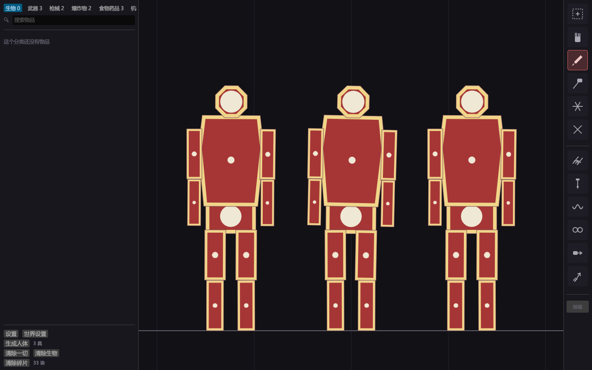

<sub>**多 ragdoll**。三具人偶，各自有独立的生理（血压、血容量、体温、血糖）和独立的组织场（一张 24672 texel 的图）。左栏底部「生成人体」在光标处再放一具。中间那具的右腿被切了一刀——另外两具身上一个 texel 都没变。</sub>

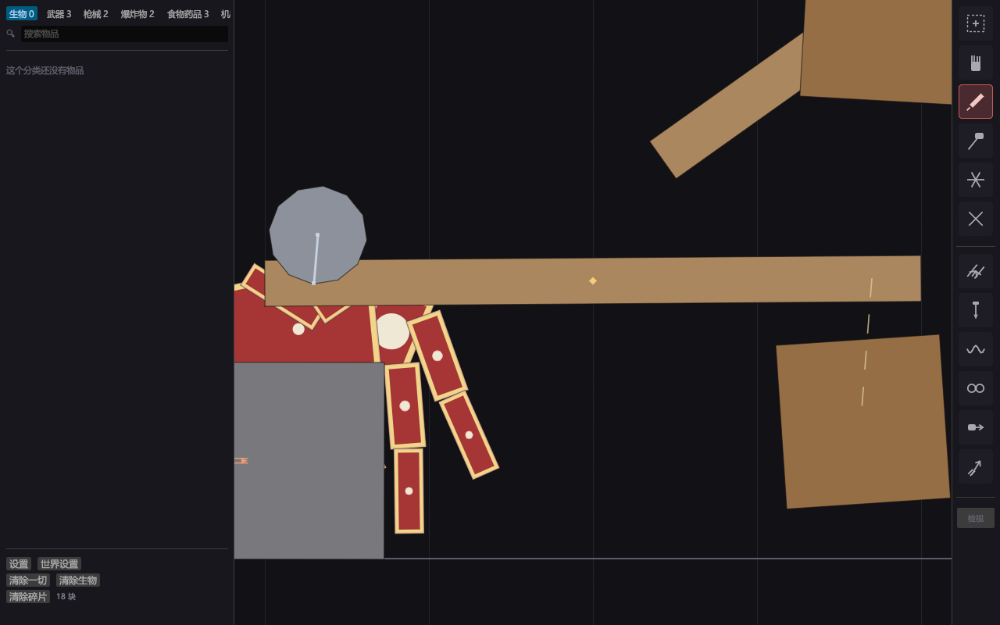

<sub>用连接工具搭的一台"天平"：**钉住**（黄色菱形）把一根长板钉在空中当支点，**焊接**（灰色粗线）把铁球焊在左端，**绳**（虚线）把木箱吊在右端，右边还有一组**铰链**（青色圆）。左下角两块水泥块之间是**活塞**（双线 + 箭头）。所有连接都能被刀切断——切到连接线就断。</sub>

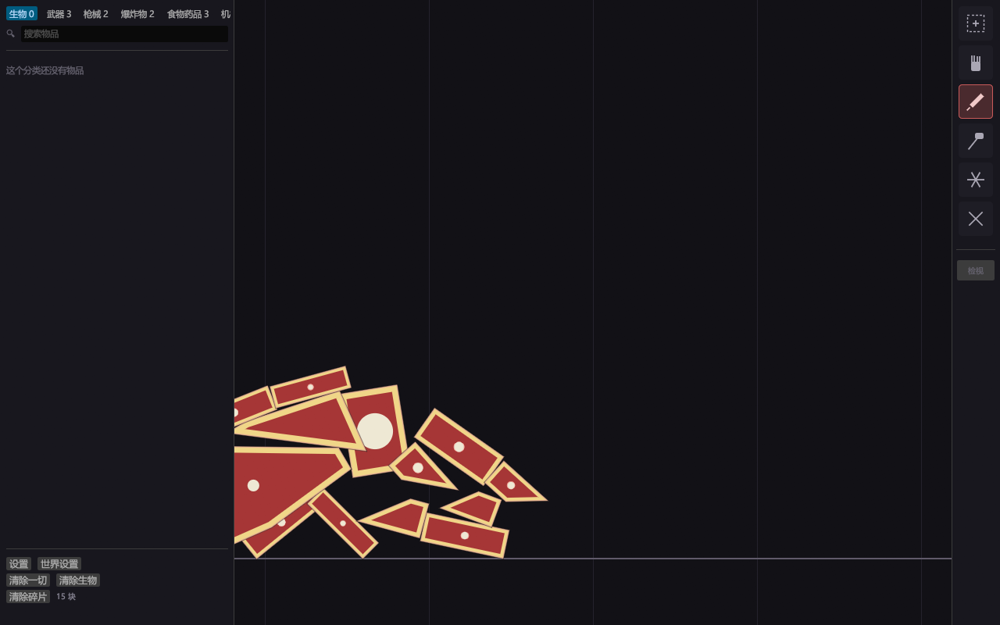

<sub>切割时喷血。参考 MaD2 `Cutter.as:956`——每一刀都在切口喷东西。没有粒子的话，切开一个人是静悄悄的：数值在流血，画面上什么都没发生。落地之后变成血迹，切过的地方会留下痕迹。</sub>

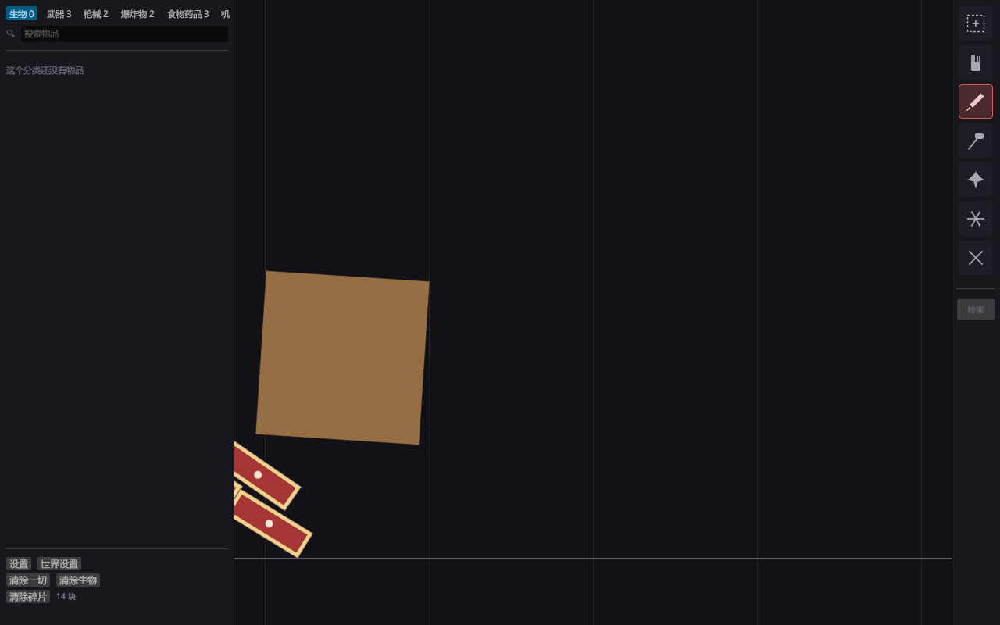

<sub>爆炸。手雷不给"爆炸伤害"这种规则，它只做一件事：半径内每块吃一个径向冲量，自己消失。剩下的由关节磨损自己算——掀飞、扭断、撕裂，全是 M3 那套状态机算出来的。</sub>

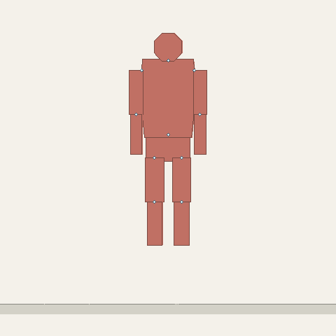

<sub>M0 输出：11 部件 / 10 关节 / 79.8 kg。落地静止后关节最大间隙 0.85 mm。</sub>

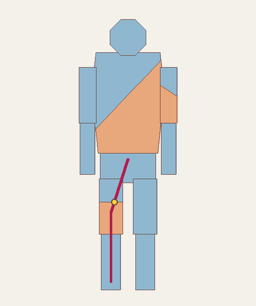

<sub>M1 输出：3 刀切出 14 块碎片，整体面积 3962.8 → 3962.8 cm²（误差 0.00000%）。暗红折线是股动脉，黄点是切口与血管的交点。</sub>

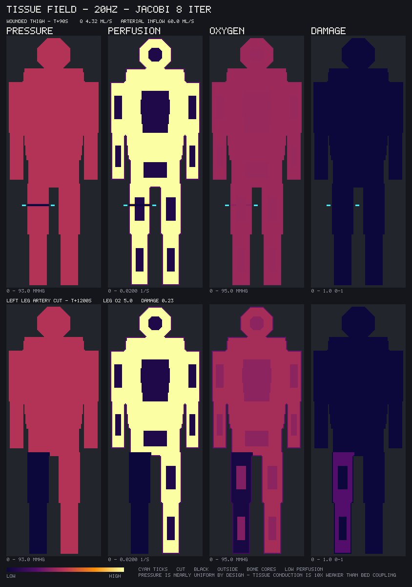

<sub>M2 输出。**上排**：大腿横断 90 秒后。压力场几乎均匀（设计如此，组织间连通只有血管床的 1/10），唯一的坑在创口；灌注面板里发黑的是骨芯；出血 4.32 mL/s。**下排**：把左腿血供切断后 1200 秒——灌注归零 → 氧分压从 40 掉到 5 mmHg → 损伤累积到 0.23，整条腿在四个通道上依次塌下去。</sub>

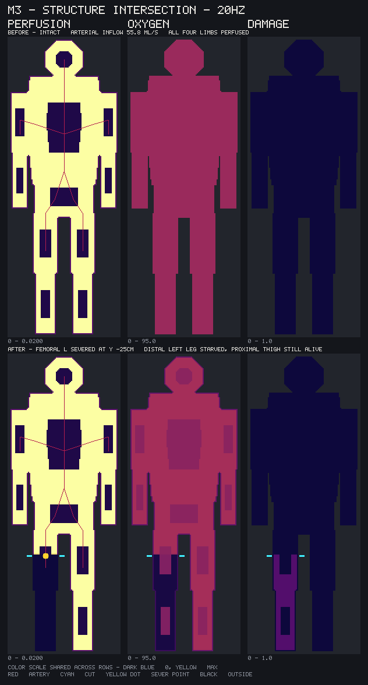

<sub>M3 输出之一。同一刀，**断口近端还活着、远端死了**。左大腿 y=-25cm 处横断，切面真的穿过了股动脉折线：断口以下的 1574 个 texel 电导清零、灌注归零，20 分钟后氧掉到 3.9 mmHg、损伤累积到 0.25；断口以上和右腿完全不受影响（灌注 0.020 1/s、氧 42.6 mmHg）。这就是"血管是折线而不是抽象边"的收益。</sub>

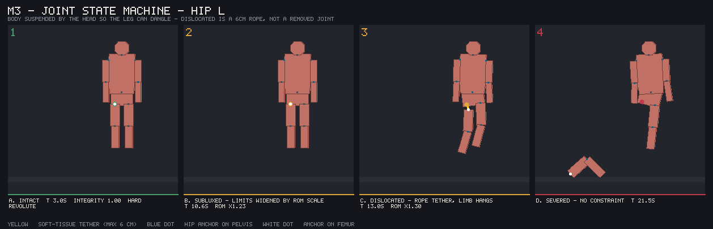

<sub>M3 输出之二。左髋从 intact 走到 severed。**第 3 帧是重点**：脱位之后肢体还挂着——黄色的软组织绳子（6cm）把它拉住，它会甩、会拉、会痛，但不会飞走。第 4 帧才是真正的离断：约束全没了，小腿掉下去。</sub>

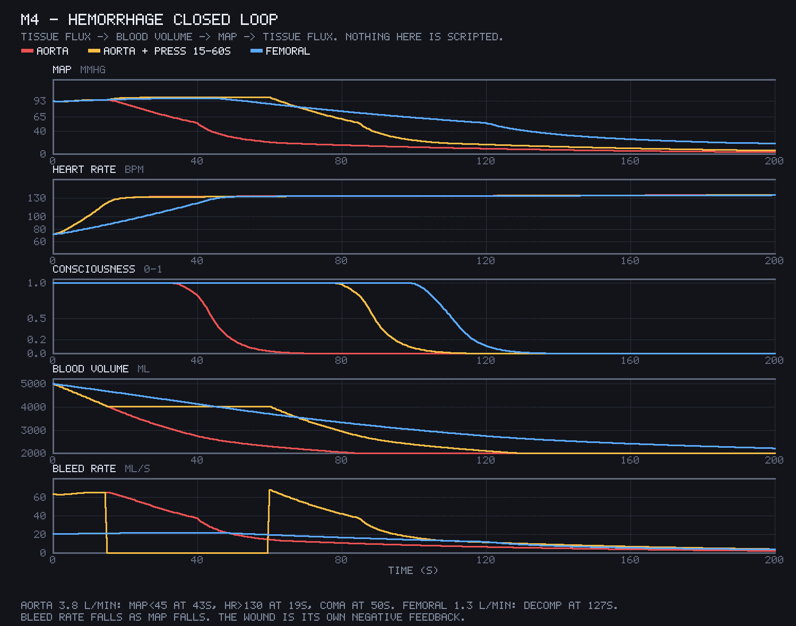

<sub>M4 输出。三条曲线，都是 `Sim::step()` 一步一步走出来的，没有一条是画上去的。**红**：横断主动脉（同时切到颈动脉和两条肱动脉），出血 3.8 L/min，MAP 在 43 秒跌破 45、心率 19 秒顶到 130、50 秒昏迷。**黄**：同样的刀，15 秒时按住创口——出血立刻归零、MAP 止跌并回升；60 秒松手，血又开始流，最终还是死。**蓝**：只断股动脉，1.3 L/min，127 秒才失代偿。看最下面那行**出血速率**：血压越低，创口流得越慢——创口自己就是自己的负反馈。</sub>

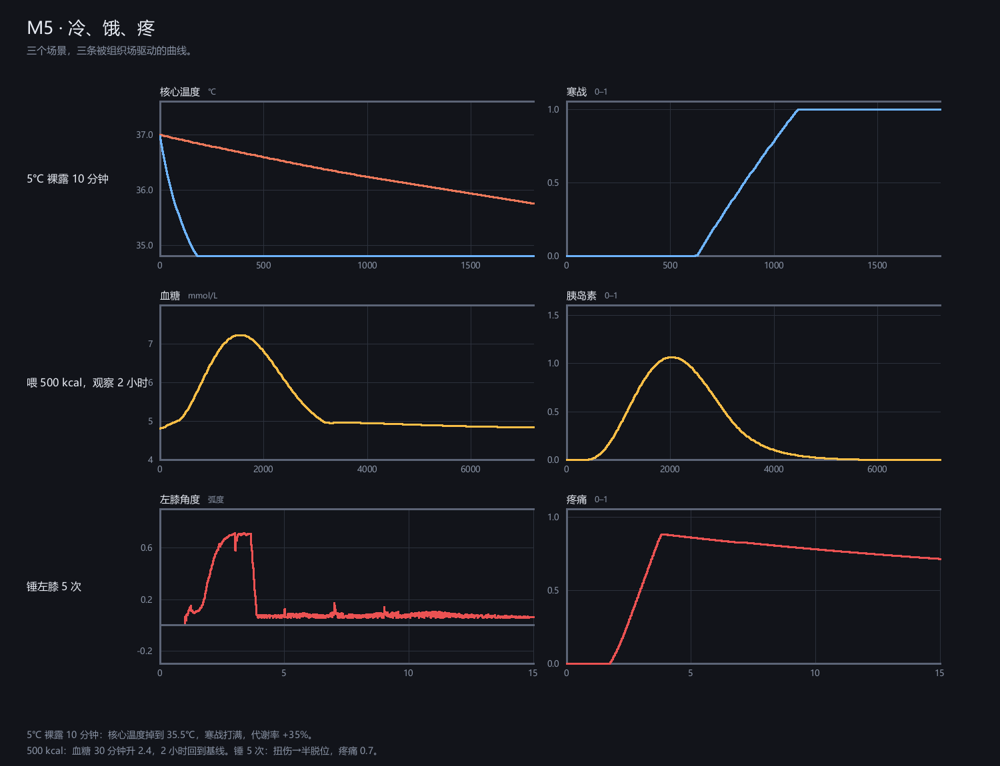

<sub>M5 输出。三条不同的驱动链，三种时间尺度。**上排 · 冷**：环境 5°C，皮肤先掉（蓝），核心慢慢跟（红），到 35.7°C 时寒战打满、代谢率 ×1.35——但散热仍有 144 W 的缺口，所以他还在继续冷下去。**中排 · 饿**：500 kcal 进胃，两个腔室（胃→小肠）串出 15 分钟的滞后相，血糖 26 分钟见顶 +2.4，胰岛素跟着上来把它按回去。**下排 · 疼**：五下打在膝上，前两下就走到半脱位；灰线是健康时的目标角度，红线是实际角度——受伤之后那条腿再也拉不回目标，整个人歪了 19°。</sub>

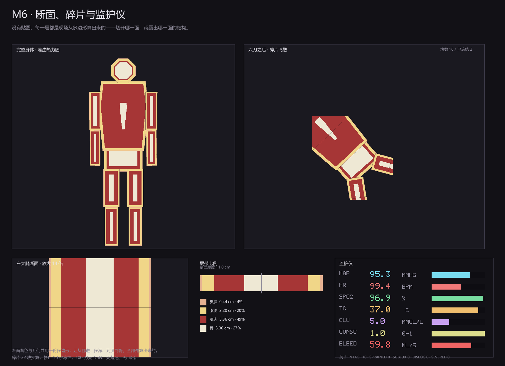

<sub>M6 输出。**左上**：完整身体的灌注热力图，黑的是骨芯和低灌注区。**右上**：六刀之后——腿、手臂、躯干、头都断了，碎片按解剖部件各自带色。**左下**：左大腿断面放大 14 倍，皮肤 4% / 脂肪 20% / 肌肉 49% / 骨 27%。**右下**：监护仪。整张图没有一张贴图，每一层都是逐像素从多边形算出来的。</sub>

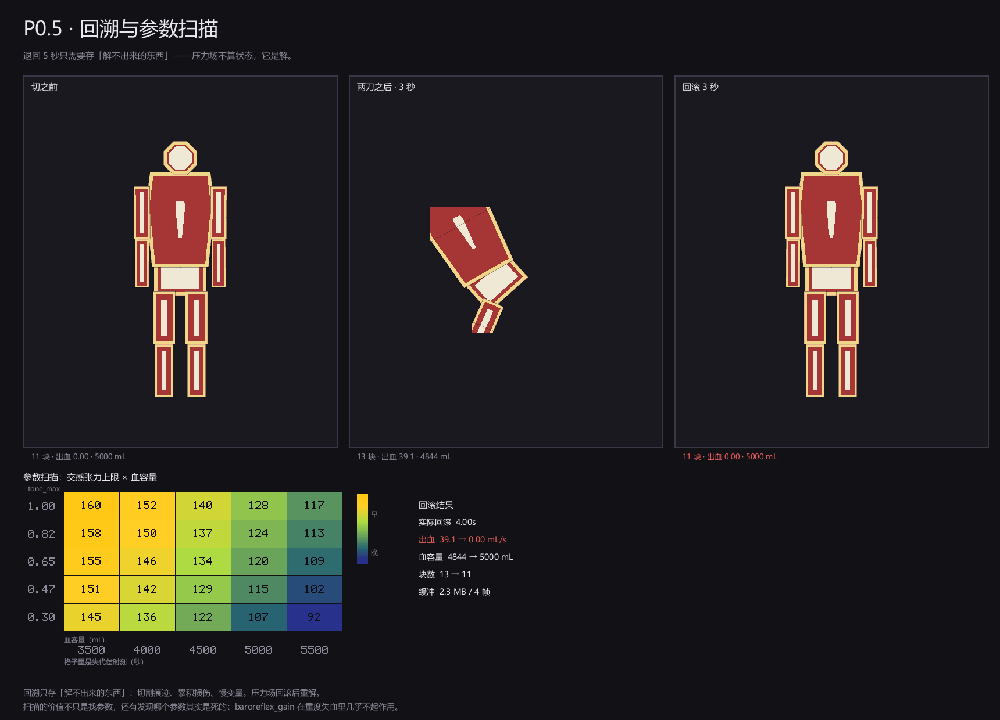

<sub>P0.5 输出。**上排**：切之前 → 两刀加断两条关节、跑 4 秒 → 回滚 4 秒。第 3 帧和切之前逐像素差 0.19%（压力场重解带来的亚像素抖动），第 2 帧差 14.2%。**下排左**：25 格参数扫描，交感张力上限 × 血容量 → 失代偿时刻，从 92 秒到 160 秒。**下排右**：回滚的关键数字——出血 39.09 → 0.00 mL/s，血容量 4844 → 5000，块数 13 → 11。</sub>

---

## 这是什么

一个单人、2D 侧视的物理沙盒。人体由多边形刚体和关节组成，可以切、可以砸、可以拉断；每一具身体还带一张逐 texel 的**组织场**，记录灌注、氧合、温度、损伤和积血。生理状态由这张场和一套腔室级循环/呼吸/代谢模型共同驱动，再反过来改变肌张力与外观。

不是血条游戏。血量是算出来的，不是填进去的。

## 不是什么

- 不是 3D，不打算做 3D
- 不是联机游戏
- 不是医学教具（只要求定性正确、量级合理）
- 不是纯破坏玩具（破坏只是驱动生理的手段）

## 三个核心机制

**1. 组织场（tissue field）**

每具身体是一张约 120×340 的标量场，每个 texel 是一种组织（皮肤/脂肪/肌肉/骨/器官）。压力场用达西流求解，创口是狄利克雷边界 `p = 0`。

于是**出血速率 = 创口边界的通量**，不是硬编码的常数。创口越大、血压越高，出血越快；失血让血压下降，出血自动减慢；按压创口能止血——把断端压回去，那个零压边界就不存在了。三条都不是特判，是同一个方程在三组边界条件下的解。

**2. 三级损伤**

| 级别 | 几何 | 物理 | 生理 |
|---|---|---|---|
| 撕裂 | 开缝不分离 | 无 | 出血、疼痛 |
| 脱位 | 关节错位，肢体还连着 | 硬约束换软 tether | 失能、牵拉伤 |
| 离断 | 完全分离 | 两个独立刚体岛 | 大出血 + 失神经 |

中间那个"脱位"是关键：肢体还挂着，会甩、会拉、会痛，但不会飞走。

**3. 关节健康四量**

`integrity`（会不会断）· `inflammation`（断了以后好不好使）· `pain`（他会怎么动）· `rom_scale`（能弯到多少度）。

一个数值只能表达"坏了多少"，四个量能表达"坏了之后是什么状态"——脱臼、复位、慢性不稳，都能演。

## 快速开始

```bash
cargo run -p anatomize-tools --bin ragdoll       # M0：ragdoll 稳定性
cargo run -p anatomize-tools --bin cut_demo      # M1：切割与结构求交
cargo run -p anatomize-tools --bin tissue_demo   # M2：组织场求解器
cargo run -p anatomize-tools --bin m3_demo       # M3：关节状态机 + 断供
cargo run --release -p anatomize-tools --bin m4_demo   # M4：失血闭环（release 才快）
cargo run --release -p anatomize-tools --bin m5_demo   # M5：冷、饿、疼
cargo run --release -p anatomize-tools --bin m6_demo   # M6：断面、碎片、监护仪
cargo run --release -p anatomize-tools --bin p05_demo  # P0.5：回溯 + 参数扫描
```

## 玩

```bash
cargo run --release -p anatomize-app          # 开发时
```

发行版：`dist/anatomize-0.1.0-win64/anatomize.exe`（双击即开）。

| 操作 | |
|---|---|
| 左键拖动 | 用当前工具 |
| 右键拖动 | 平移视角 |
| 滚轮 | 缩放 |
| 空格 | 暂停 |
| **Q** | 在光标处放置选中的物品 |
| **E** | 镜像放置（左右翻转） |
| ` / 1 / 2 / 3 / 4 / 5 | 选择 / 手 / 刀 / 锤 / 冻结 / 删除 |
| 6 / 7 / 8 / 9 / 0 / L | 焊接 / 钉住 / 绳 / 铰链 / 活塞 / 发射 |
| Tab | 检视当前生物 |
| ESC | 回主菜单 |
| R | 视角复位 |
| F1 / F2 | 血管关节 / 热力图（都跟着身体转） |

## 多 ragdoll

一个世界可以有很多具。左栏底部「生成人体」在光标处再放一具，检视窗口（Tab）顶上
会多出一排标签，点一下就切到那一具。

**共用的**：物理世界（`rapier` 的刚体/碰撞体/关节）、块表、物品目录、切割预算。
**各管各的**：生理（`Physio`）、组织场（一张 24672 texel 的图）、姿态目标、环境温度。

为什么块表是全局的而不是每具一份：两具身体的碎块要互相碰撞，一把刀要能同时切到
两具。`PieceId` 全局唯一，所以切割 / 冻结 / 删除 / 拾取 / 渲染**一行都没改**——
它们本来就只认块。需要按生物区分的只有"这具的生理""这具的场""这具的姿态"。

```
Sim
├── physics        一个 rapier 世界（所有刚体）
├── body.pieces    所有块，每块带 `creature` 标签
├── body.joints    所有解剖关节，每条带 `creature` 标签
├── conns          玩家连的东西（焊接 / 绳 / 活塞 …）
└── creatures[]
    ├── primary    每个部件由哪块代表
    ├── parts      部件句柄
    ├── physio     0D 生理
    ├── tissue     组织场
    └── posture    姿态目标 + 电机
```

**刀是世界的，不是生物的**：一次切割会对每一具有组织场的身体各转一次坐标、各切一刀。
没被扫到的那具，场里一个 texel 都不会变（`apply_cut` 只在刀线真的穿过组织的地方留创口）。

## 工具

两段：**改身体**（选择 / 手 / 刀 / 锤 / 冻结 / 删除）和**造结构**（焊接 / 钉住 / 绳 / 铰链 / 活塞 / 发射）。

| 工具 | 行为 | 对应 MaD2 |
|---|---|---|
| 焊接 | 点两块，焊成刚体 | `WELD` |
| 钉住 | 点一块，钉在世界点上 | `PIN` |
| 绳 | 点两块，拉一根绳（只限最远距离） | `ROPE` |
| 铰链 | 点两块，装一个转轴 | `JOINT` |
| 活塞 | 点两块装活塞；点已有活塞切换伸出/收回/停 | `PISTON` |
| 发射 | 点一块，朝鼠标方向甩出去 | `LAUNCH` |

**切割会断连接**：刀线穿过一条连接（焊接 / 绳 / 铰链 / 活塞，或者解剖关节的转轴）
就把它切断。这是 MaD2 的 `Cutter.CutJoints`——**先断关节再切形状**，顺序不能反。
只有刀和剪刀会断关节，子弹和激光不会（MaD2 同理）。

**每帧切割上限 12 块**（MaD2 的 "Max Cuts / Frame"，默认 10，`Cutter` 静态值 12）。
这是防冻屏的护栏，不是优化：一刀扫过整具身体会产出十几块，再多求解器一帧解不完。

**拖拽是一条弹簧关节**，不是"每帧加一个力"。抓力、肘关节、肩关节、接触力
一起进求解器解，所以抓着一只手拖，身体会绕肩膀翻转、腿会甩——而且**不会抖**。

> 第一版是每物理步 `add_force_at_point`。抓自由物体还行，抓连在身上的肢体直接
> 炸：外力被关节约束用冲量抵消，净效果是把冲量变成了旋转。实测抓前臂画圈，
> 那块转到 **370 rad/s**（每秒 59 圈）。改成 `SpringJoint` + 运动学锚点之后
> 是 **12 rad/s**，线速度 20 → 2.8 m/s。

**人偶站着**：姿态控制用的是 rapier 的**关节电机**（隐式约束），不是外部力矩。
`human_01.ron` 里每条关节的刚度（髋 1500、膝 1200）终于被用上了——之前一直是
一个全局的 26，撑不住体重。

物品的「使用」按 `tag` 分发：`explosive` 引爆、`gun` 开火（射线切一刀）、`food` 吃掉。
手拖着某块时按 **F** 触发。

**物品是「先选后放」**：左栏点一下卡片选中（卡片会亮起黄边），然后在世界里按
Q 放在光标处、按 E 镜像放。位置由鼠标决定，不是相机。

物品在 `assets/items.ron` 里，按分类组织。加一个物品 = 加一条 RON：

```ron
(
    id: "axe", name: "斧头", category: "melee",
    shape: Poly(points: [(0.0, 40.0), (9.0, 30.0), (2.0, 20.0), (2.0, -40.0), (-2.0, -40.0), (-2.0, 20.0)]),
    mass: 2.0, color: (150, 120, 90), desc: "重，能劈",
),
```

形状会自动凸包化（物理和渲染都只吃凸多边形）。想加行为就挂 `tag: "explosive"`，
宿主按 tag 分发——目录本身保持纯数据。

界面是 egui 做骨架（布局、命中、hover）+ 图标自绘。为什么是 eframe 不是 Bevy，见 ADR-028。

## 批量实验

调参是这个项目里最花时间的事——几乎每个数字都是标定出来的。所以有一个专门的 CLI：

```bash
# 扫一维
cargo run --release -p anatomize-tools --bin scan -- \
    --scenario bleed-femoral --param tone_max=0.3:1.0:0.175 --fast

# 扫二维（笛卡尔积）
cargo run --release -p anatomize-tools --bin scan -- \
    --scenario bleed-femoral \
    --param tone_max=0.5:1.0:0.25 --param blood_volume_ml=4000:5500:500 \
    --out scan.csv
```

五个场景：`bleed-aorta` / `bleed-femoral` / `cold` / `feed` / `hammer`。
`--fast` 把组织场降到 1Hz，快十倍（验验收标准时不要用）。

它最大的用处不是"找最优参数"，而是**发现哪个参数其实是死的**：
`baroreflex_gain` 从 0.4 扫到 2.0，失代偿时刻只动 0.8 秒——因为交感张力
早就被 `clamp` 到 `tone_max` 了，增益只决定"多快饱和"。真正改变结局的是
`tone_max` / `svr_gain` / `rvr_gain` / `blood_volume_ml`。

`ragdoll` headless 跑 600 tick（10 秒），在 `out/` 下写出若干帧，并打印稳定性判定：

```
关节最大间隙 0.847 mm（阈值 2.0 mm）-> PASS
末态动能 0.0000 J（阈值 0.05 J，说明已静止）-> PASS
无 NaN -> PASS
最大速度 0.000 m/s（阈值 50 m/s）-> PASS
```

`cut_demo` 对 torso / thigh_l / upper_arm_r 各切一刀，校验面积守恒并输出碎片图：

```
总计 14 块碎片，整体面积 3962.8 -> 3962.8 cm²（误差 0.00000%）

结构求交：股动脉折线 vs 大腿切口 -> 1 处命中
  命中于段 0  s=0.80  (-0.064, -0.250) m
```

`tissue_demo` 把 human_01 光栅化成 2.4 万 texel 的组织场，扫 MAP 看出血通量：

```
组织场 96×257 = 24672 texel（texel 0.50 cm），其中组织 texel 14972
  无创口稳态：组织压 44.60 mmHg，全身动脉流入 55.78 mL/s，组织氧 39.90 mmHg

     MAP    Q (mL/s)         Q/MAP
    40.0      1.8602      0.046504
    93.0      4.3232      0.046486
   140.0      6.5074      0.046481
  拟合 Q = 0.046472·MAP + 0.001293，最大偏离 0.000%
```

`m3_demo` 切三刀、掰一个关节，输出两张验收图：

```
  切法                               命中    断供texel       创口      出血 mL/s
  大腿横断（穿过股动脉）                 1       1574       44        20.98
  贴着动脉划过（擦伤）                   1          0       20         2.14
  浅划（没够到血管）                     0          0       10         1.65

  状态               t(s)   integrity    tether          约束
  intact            0.0       1.000      1.00    revolute
  sprained         6.28       0.700      1.00  revolute (loose)
  subluxed        10.28       0.340      1.00  revolute (very loose)
  dislocated      12.68       0.148      1.00    rope 6cm
  severed         19.95       0.128      0.00        none
```

三刀落在同一条大腿上，唯一的区别是**刀口停在哪里**——这是几何求交相对"能量阈值"的全部意义。
擦伤只出血不断供（2.14 mL/s，腿还活着）；浅划连血管都没碰到（1.65 mL/s，纯软组织创口）。

> 横断那一行的 20.98 里，4.31 是 M2 的**几何创口通量**（那一刀顺带切开的毛细血管床），
> 另外 16.67 是 M4 新加的**断端电导**：股动脉占心输出量 20%，`0.20 × 5 L/min ÷ 93 mmHg`。
> 一根血管断了能流多少血，由这根血管自己的口径决定，不由"伤口面积"决定。

`m4_demo` 跑三个场景、每个 200 秒真闭环，输出上面那张五联图：

```
[AORTA] 命中 4 处，创口 128 texel，断供 8522 texel，断端电导 0.538，即刻出血 63.87 mL/s（3.8 L/min）
  结果：MAP<45 @ 42.5s，HR>130 @ 19.0s，意识<0.2 @ 50.0s；终末 MAP 3.8，血量 1352，失血 3648 mL

[AORTA + PRESS 15-60S]
  t=15.0s 按压 → 出血 0.000 mL/s
  t=60.0s 松开 → 出血 68.28 mL/s
  结果：MAP<45 @ 87.5s，HR>130 @ 19.0s，意识<0.2 @ 95.0s

[FEMORAL] 命中 1 处，创口 44 texel，断供 1574 texel，断端电导 0.179，即刻出血 20.98 mL/s（1.3 L/min）
  结果：MAP<45 @ 127.0s，HR>130 @ 45.5s，意识<0.2 @ 116.5s
```

同一个伤，按不按创口，结局差 45 秒。这就是这个项目想要的东西。

`m5_demo` 跑三个场景，输出上面那张六联图：

```
[冷] 5°C 30 分钟：核心 35.76°C，皮肤 32.93°C，寒战 1.00，代谢率 ×1.35，热平衡 -144 W
[饿] 500 kcal → 438 mmol 葡萄糖当量，基线 4.82 mmol/L
[饿] 峰值 7.24 @ 26 分钟，30 分钟 7.09，120 分钟 4.85
[疼] 锤 5 次：Sprained/i=0.55/p=0.52 → Subluxed/i=0.20/p=0.86 → Subluxed/i=0.20/p=0.82
     → Subluxed/i=0.19/p=0.80 → Subluxed/i=0.19/p=0.77
[疼] 终态 Subluxed，integrity 0.19，疼痛 0.71，躯干倾角 18.9°
```

同一条大腿、同一个膝盖，疼与不疼的差别是 19° 的躯干倾角——不是一段动画，
是"肌张力 × (1 − 0.85·疼痛)"这一个数把力矩压下去之后，物理自己算出来的。

不需要窗口、不需要 GPU —— 这是核心与宿主解耦的直接好处。

## 界面语言

验收图上的字默认是中文。语言外置在 `assets/config/ui.ron`：

```ron
(lang: Zh,   // 或 En
)
```

也可以临时覆盖，不用改文件：

```bash
cargo run --release -p anatomize-tools --bin m5_demo -- --lang en
ANATOMIZE_LANG=en cargo run --release -p anatomize-tools --bin m5_demo
```

中文字形用系统字体渲染（Windows 的微软雅黑、macOS 的苹方、Linux 的 Noto CJK），
**字体文件不进仓库**。找不到中文字体会自动退回英文并打印一行警告——
画一堆方块比少一种语言更糟。要指定字体就设 `ANATOMIZE_FONT=/path/to/font.ttc`。

## 代码结构

| Crate | 职责 | 依赖引擎/物理？ |
|---|---|---|
| `anatomize-core` | ID、时间、确定性随机、伤害事件 | 否 |
| `anatomize-body` | `BodyPlan` schema、编译、校验 | 否 |
| `anatomize-tissue` | 组织场：压力 / 灌注 / 氧 / 热 / 损伤（M2） | 否 |
| `anatomize-physio` | 0D 腔室生理：循环 / 呼吸 / 神经 / 代谢 / 体温（M4/M5） | 否 |
| `anatomize-cut` | 多边形裁剪、凸分解、切面 × 血管折线求交、断面分层（M1/M3/M6） | 否 |
| `anatomize-sim` | 世界编排、rapier2d 驱动、关节健康 ↔ 约束桥接、断供耦合、L2↔L4 闭环、碎片与存档（M3–M6） | 仅 rapier2d |
| `anatomize-tools` | headless 实验、帧渲染、断面着色、参数扫描、中文文字、中英文案表 | 否 |
| `anatomize-app` | **可玩的宿主**：窗口、相机、工具、物品栏、存档 UI | eframe / egui |

前五个 crate 的 `Cargo.toml` 里不允许出现 `bevy` / `wgpu` / `rapier`。

## 文档

| 文件 | 内容 |
|---|---|
| [设计文档-v0.2.md](设计文档-v0.2.md) | 完整设计：crate 划分、组织场、器官/关节图 schema、切割管线、P0 范围与验收 |
| [参考.md](参考.md) | v0.1 早期草案（已被 v0.2 取代，保留作对照） |

## 路线图

| 阶段 | 交付物 |
|---|---|
| ✅ M0 | workspace 骨架、rapier2d 直驱、11 部件 ragdoll、固定 tick |
| ✅ M1 | 多边形裁剪 + 凸分解 + 切面折线（12 测试，含 10000 次 fuzz） |
| ✅ M2 | 组织场：压力求解 + 灌注 + 创口通量（15 测试，解析解误差 0.003%） |
| ✅ M3 | 关节三级状态机 + 结构求交（新增 14 测试：5 结构求交 + 4 断供 + 5 真实 rapier 世界的关节集成） |
| ✅ M4 | 循环 / 呼吸 / 神经 / 代谢闭环 + 断端电导（新增 27 测试：4 多速率 + 18 生理单元 + 5 真闭环集成） |
| ✅ M5 | 温度调节 + 消化 + 疼痛与姿态，中英文界面（新增 15 测试：3 语言 + 2 代谢 + 6 场景 + 4 渲染） |
| ✅ M6 | 断面分层着色 + 碎片刚体化 + 冻结 + 监护仪 + 存档（新增 15 测试：6 断面 + 9 碎片/存档/性能） |
| ✅ P0.5 | 5 秒回溯 + 参数扫描 CLI（新增 5 测试） |
| ✅ 窗口版 | `anatomize-app`：PP 式三段布局 + 自绘图标 + 道具生成 + 世界尺寸 + 存档读写（全 workspace 121 个） |

顺序铁律：M2 必须在 M4 之前。没有通量，生理层就只能拍脑袋写常数。

## 技术栈

Rust · Bevy（仅宿主）· rapier2d（直接驱动）· serde + RON

核心 crate 不依赖 Bevy / wgpu / rapier，保证 `anatomize-tools` 能 headless 跑参数扫描。

## 名字

**Anatomize** /əˈnætəmaɪz/ — 解剖、剖析。动词，不是名词：这个项目的重点不是"人体长什么样"，而是"把它拆开之后会发生什么"。
